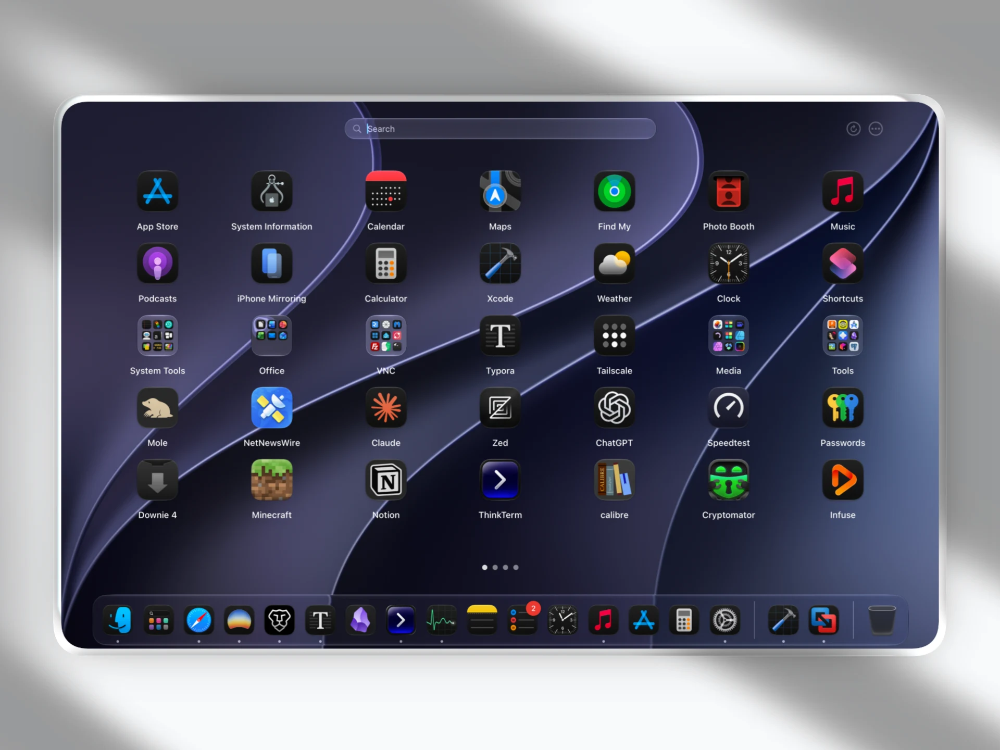
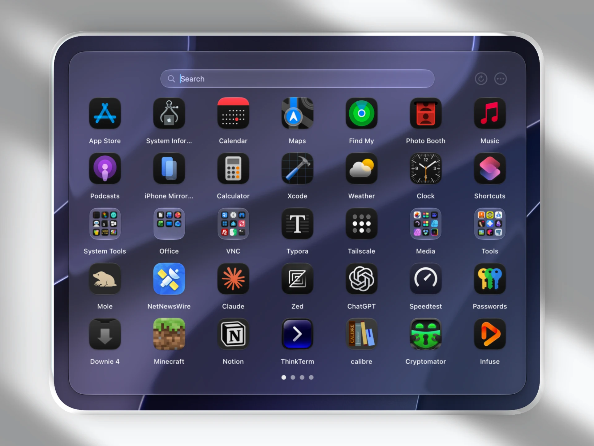
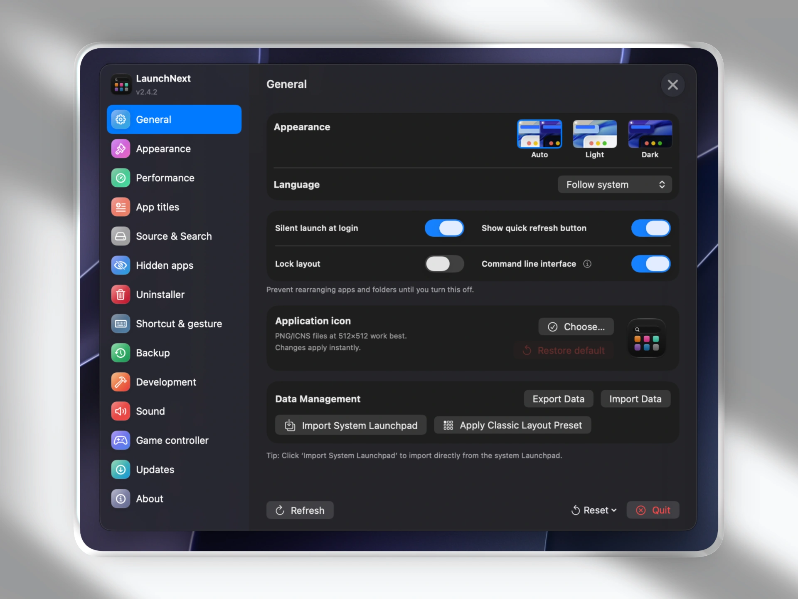
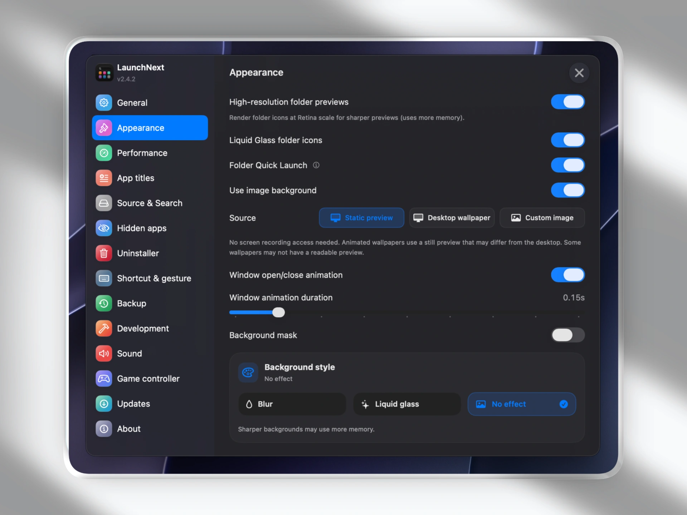

# launch

**Языки**: [English](../README.md) | [简体中文](README.zh.md) | [繁體中文](README.zh-TW.md) | [日本語](README.ja.md) | [한국어](README.ko.md) | [Français](README.fr.md) | [Español](README.es.md) | [Deutsch](README.de.md) | [Русский](README.ru.md) | [हिन्दी](README.hi.md) | [Tiếng Việt](README.vi.md) | [Italiano](README.it.md) | [Čeština](README.cs.md) | [Polski](README.pl.md)

## 📥 Скачать

**[Скачать здесь](https://github.com/yongzhuanghuo/launch/releases/latest)** - Получить последнюю версию

🌐 **Сайт**: [closex.org/launch](https://closex.org/launch/)  
📚 **Документация**: [docs.closex.org/launch](https://docs.closex.org/launch/)

⭐ Рассмотрите возможность поставить звезду [launch](https://github.com/yongzhuanghuo/launch) и особенно оригинальному проекту [LaunchNow](https://github.com/ggkevinnnn/LaunchNow)!

🖥️ Попробуйте также мой новый терминальный мультиплексор для агентов с открытым исходным кодом [ThinkTerm](https://github.com/RoversX/ThinkTerm) — я работал над ним больше полугода 🥺

| | |
|:---:|:---:|
|  |  |
|  |  |

macOS Tahoe убрала launchpad, и им так сложно пользоваться, он не использует ваш Bio GPU. Пожалуйста, Apple, хотя бы дайте людям возможность переключиться обратно. А пока, вот launch.

*Создано на основе [LaunchNow](https://github.com/ggkevinnnn/LaunchNow) от ggkevinnnn — огромное спасибо оригинальному проекту!❤️*

*LaunchNow выбрал лицензию GPL 3. launch следует тем же условиям лицензии.*

⚠️ **Если macOS блокирует приложение, выполните это в Терминале:**
```bash
sudo xattr -r -d com.apple.quarantine /Applications/launch.app
```
**Почему**: Я не могу позволить себе сертификат разработчика Apple ($99/год), поэтому macOS блокирует неподписанные приложения. Эта команда удаляет флаг карантина, чтобы позволить запуск. **Используйте эту команду только для доверенных приложений.**

## Что дает launch

- ✅ **Импорт в один клик из старого системного Launchpad** - напрямую читает нативную SQLite-базу Launchpad и восстанавливает папки, позиции приложений и компоновку
- ✅ **Ручная организация приложений** - перемещайте приложения, создавайте папки и сохраняйте нужную вам структуру
- ✅ **Два пути рендеринга** - `Legacy Engine` для совместимости и `Next Engine + Core Animation` для лучшего опыта
- ✅ **Компактный и полноэкранный режимы** - с поддержкой раздельных настроек
- ✅ **Клавиатурный workflow** - быстрый поиск, навигация и запуск
- ✅ **Поддержка CLI / TUI** - просматривайте и управляйте компоновкой из терминала
- ✅ **Активация через Hot Corner и нативные жесты** - несколько способов глобально открыть launch
- ✅ **Перетаскивание приложений прямо в Dock** - доступно в движке Core Animation
- ✅ **Центр обновлений с Markdown release notes** - более богатый встроенный опыт обновлений
- ✅ **Инструменты резервного копирования и восстановления** - более безопасный экспорт и возврат данных
- ✅ **Доступность и поддержка контроллера** - улучшены голосовая обратная связь и навигация с контроллера
- ✅ **Многоязычная поддержка** - широкое покрытие локализаций

## Что забрал macOS Tahoe

- ❌ Нет пользовательской организации приложений
- ❌ Нет пользовательских папок
- ❌ Нет настройки перетаскиванием
- ❌ Нет визуального управления приложениями
- ❌ Принудительная категориальная группировка

## Хранение данных

Данные приложения хранятся здесь:

```text
~/Library/Application Support/launch/Data.store
```

## Нативная интеграция с Launchpad

launch может напрямую читать системную базу Launchpad:

```bash
/private$(getconf DARWIN_USER_DIR)com.apple.dock.launchpad/db/db
```

## Установка

### Требования

- macOS 26 (Tahoe) или новее
- Процессор Apple Silicon или Intel
- Xcode 26 (для сборки из исходников)

### Сборка из исходного кода

1. **Клонируйте репозиторий**
   ```bash
   git clone https://github.com/yongzhuanghuo/launch.git
   cd launch
   ```

2. **Откройте в Xcode**
   ```bash
   open launch.xcodeproj
   ```

3. **Соберите и запустите**
   - Выберите целевое устройство
   - Нажмите `⌘+R`, чтобы собрать и запустить
   - Или `⌘+B`, чтобы только собрать

### Сборка из командной строки

**Обычная сборка:**
```bash
xcodebuild -project launch.xcodeproj -scheme launch -configuration Release
```

**Универсальный бинарник (Intel + Apple Silicon):**
```bash
xcodebuild -project launch.xcodeproj -scheme launch -configuration Release ARCHS="arm64 x86_64" ONLY_ACTIVE_ARCH=NO clean build
```

## Использование

### Начало работы

1. launch при первом запуске сканирует все установленные приложения
2. Импортируйте старый layout Launchpad или начните с пустого layout
3. Используйте поиск, клавиатуру, drag-and-drop и папки для организации приложений
4. Откройте Настройки, чтобы настроить движок, режим отображения, способы активации и автоматизацию

### Импорт вашего Launchpad

1. Откройте Настройки
2. Нажмите **Import Launchpad**
3. Ваши существующие папки и компоновка будут импортированы автоматически

### Движки и режимы отображения

- **Legacy Engine** - сохраняет старый путь рендеринга для максимальной совместимости
- **Next Engine + Core Animation** - рекомендуется для лучшего общего опыта и новых функций
- **Компактный / Полноэкранный** - launch поддерживает оба режима и может хранить отдельные настройки

## Ключевые возможности

### Активация и ввод

- **Поддержка Hot Corner** - открывайте launch из настраиваемого угла экрана
- **Экспериментальная поддержка нативных жестов** - действия pinch / tap четырьмя пальцами
- **Поддержка глобальных горячих клавиш** - открывайте launch откуда угодно
- **Перетаскивание в Dock** - передавайте приложения прямо в Dock macOS через движок Core Animation

### Автоматизация и workflow для продвинутых пользователей

- **Поддержка CLI / TUI** - просматривайте компоновки, ищите приложения, создавайте папки, перемещайте приложения и автоматизируйте workflow
- **Подходит для agent workflow** - хорошо работает с терминальными AI agent и shell-автоматизацией
- **Включение командной строки из Настроек** - можно установить или удалить управляемую команду `launch`

### Обновления

- **Встроенный центр обновлений** - проверяйте обновления, не выходя из приложения
- **Markdown release notes** - более богатое отображение в Настройках
- **Современный API уведомлений** - обновленная доставка уведомлений для новых версий macOS

### Резервное копирование и восстановление

- Создавайте и восстанавливайте резервные копии из Настроек
- Более надежный экспорт резервных копий
- Более безопасная обработка временных файлов и очистки

### Доступность и навигация

- **Голосовая поддержка** - озвучивание приложений и папок при навигации
- **Поддержка контроллера** - управляйте launch и папками с игрового контроллера
- **Клавиатурное взаимодействие** - быстрый поиск и навигация без мыши

## Производительность и стабильность

- Интеллектуальное кэширование иконок для плавного просмотра
- Ленивые загрузки и фоновое сканирование для больших библиотек
- Лучшая синхронизация состояния между настройками и навигацией
- Повышенная надежность обновлений, экспорта резервных копий и восстановления жестов

## Устранение неполадок

### Общие проблемы

**Q: Приложение не запускается?**  
A: Убедитесь, что у вас macOS 26 или новее, при необходимости снимите quarantine и используйте только доверенную сборку.

**Q: Какой движок использовать?**  
A: `Next Engine + Core Animation` рекомендуется для лучшего опыта. Используйте `Legacy Engine` только если вам действительно нужен старый путь совместимости.

**Q: Почему команда CLI еще не существует?**  
A: Сначала включите интерфейс командной строки в Настройках. launch может установить и удалить управляемый shim `launch` за вас.

## Вклад

Вклад приветствуется.

1. Сделайте fork репозитория
2. Создайте feature-ветку (`git checkout -b feature/amazing-feature`)
3. Закоммитьте изменения (`git commit -m 'Add amazing feature'`)
4. Запушьте ветку (`git push origin feature/amazing-feature`)
5. Откройте Pull Request

### Руководящие принципы разработки

- Следуйте стилевым соглашениям Swift
- Добавляйте осмысленные комментарии к сложной логике
- По возможности тестируйте на нескольких версиях macOS
- Не размазывайте экспериментальные функции по несвязанным файлам
- По возможности изолируйте снимаемые интеграции

## Будущее управления приложениями

Пока Apple уходит от настраиваемых лаунчеров приложений, launch старается сохранить ручную организацию, контроль пользователя и быстрый доступ на современном macOS.

**launch** — это не просто замена Launchpad, а практичный ответ на деградацию рабочего процесса.

---

**launch** - Верните контроль над своим лаунчером приложений 🚀

*Для пользователей macOS, которые не хотят идти на компромисс в настройке интерфейса.*

## Инструменты разработки

- Claude Code
- Cursor
- OpenAI Codex CLI
- Perplexity
- Google

- Экспериментальная поддержка жестов построена на [OpenMultitouchSupport](https://github.com/Kyome22/OpenMultitouchSupport) и форке [KrishKrosh](https://github.com/KrishKrosh/OpenMultitouchSupport).❤️


